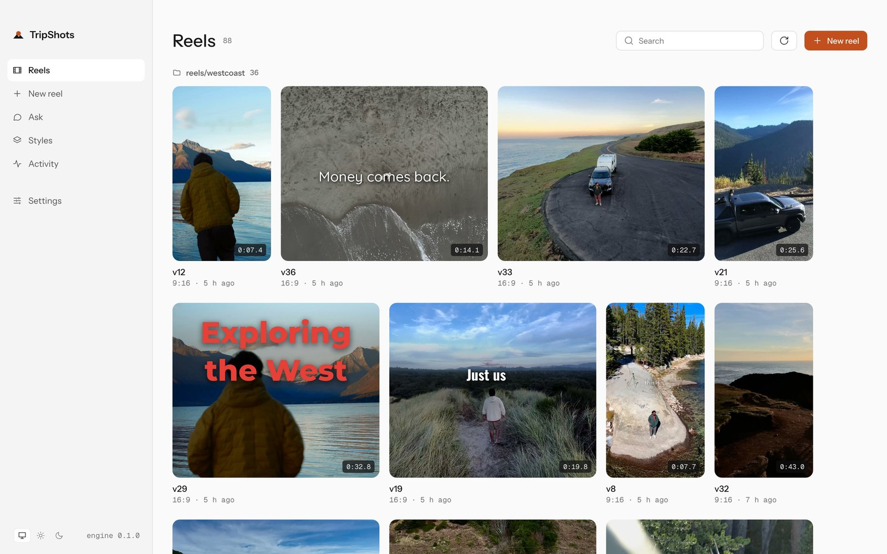
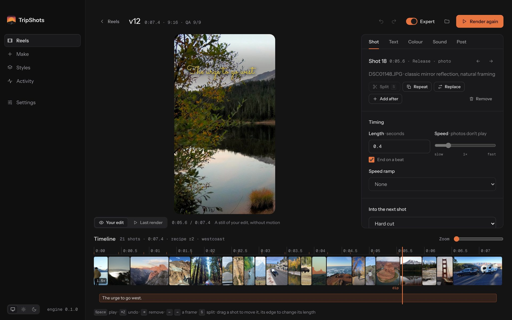
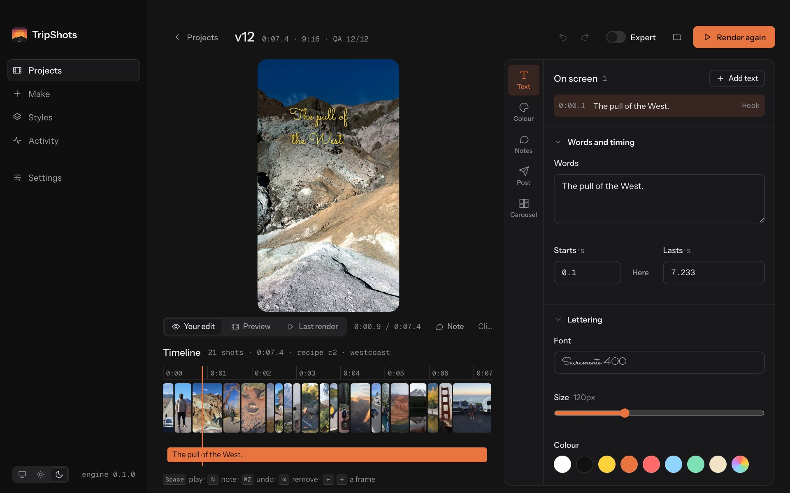
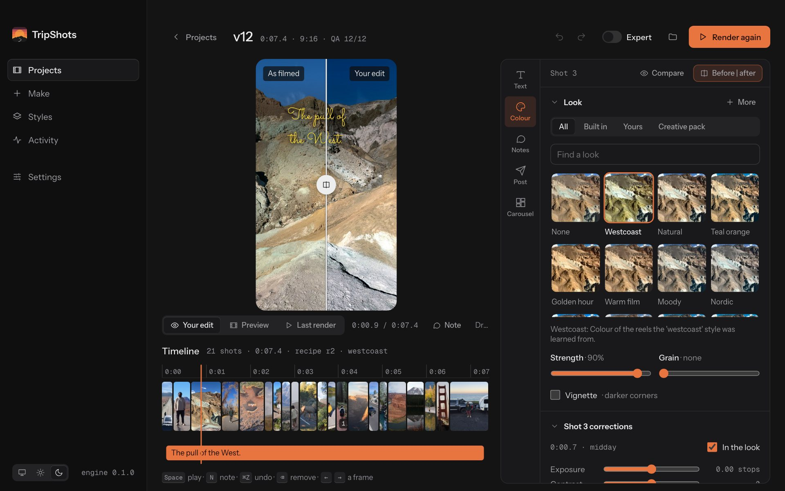
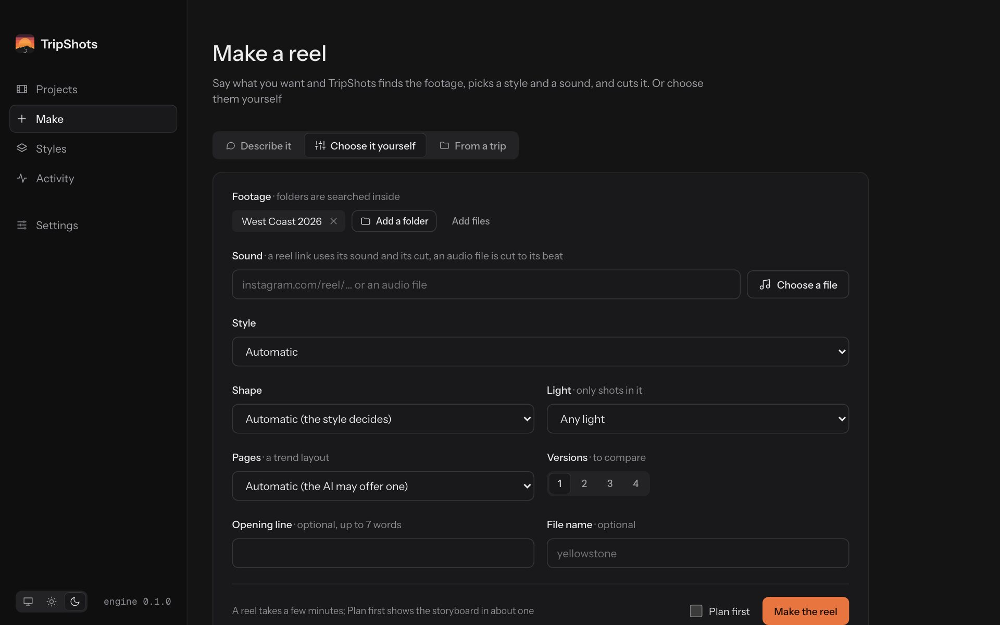
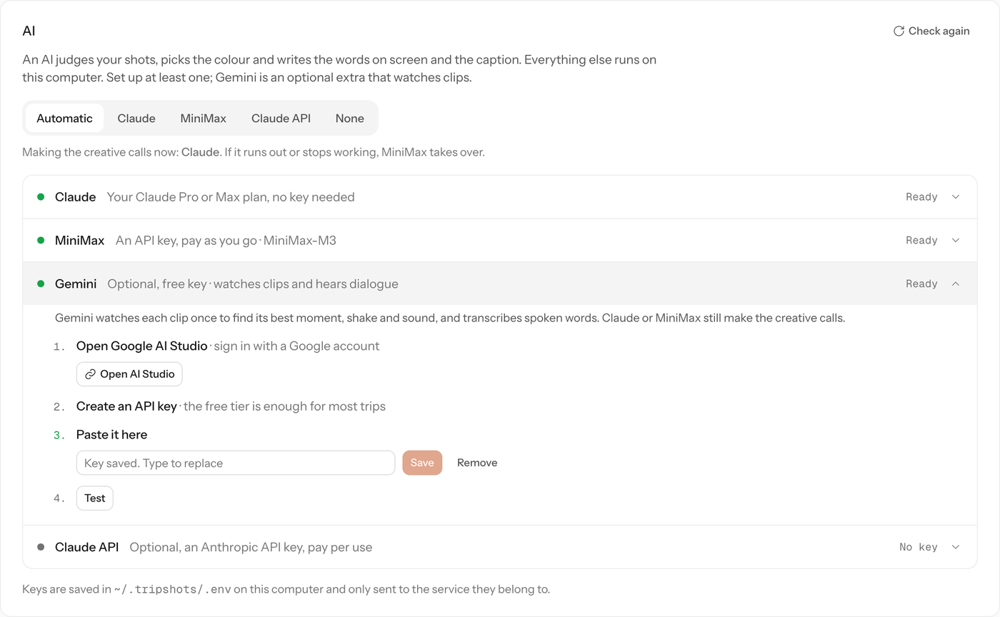
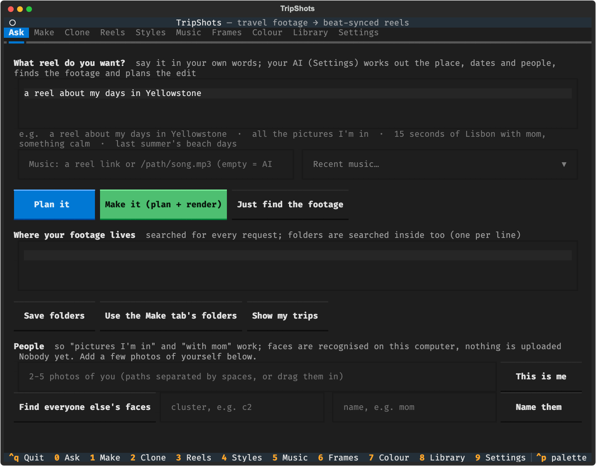

# TripShots

**Turn your own travel photos and clips into beat-synced Instagram Reels, by hand or by asking an AI.**

Point TripShots at a trip folder and a song, or just say *"make a reel about my days in Yellowstone"*. It finds the
right footage, picks the strongest shots, cuts them on the beat, grades the colour, adds text, motion and sound
effects, and renders a reel ready to post: upright 1080×1920, or a real 1920×1080 when your footage is wide.

Nothing is generated: every frame is your own footage. Use it as a desktop app for macOS, Windows and Linux, from the
command line, or through an AI agent.



```
your footage ─► find shots ─► AI judges each shot ─► beats of the song ─► edit plan ─► 1080×1920 reel
(SSD, phone,     (cuts, blur,    (light, composition,    (cuts on the beat,   (plan.json +     (+ cover, caption,
 drone, GoPro)    shake, GPS)     subject, hook)          calm shots in        storyboard you   EDL, sound design)
                                                          quiet parts)         can edit)
```

## Highlights

- **Learns from reels you like:** give it Instagram reel links and it learns each one's cut, picture shape, words and lettering; a reel made on one of those sounds follows that reel's recipe, with its exact on-screen words in the closest matching font ([how](docs/storytelling.md#recipes-from-reference-reels)).
- **Ask for footage the way you'd describe it:** by place ("Yellowstone National Park", matched by GPS inside its real outline), dates, or who's in it ("the pictures I'm in", "Lisbon with mom"), using face recognition that runs on your computer.
- **Works with AI agents:** an [MCP server](docs/agents.md) for Claude Code, Claude Desktop, OpenClaw and any MCP agent, plus a portable [agent skill](skills/tripshots/SKILL.md) and `tripshots ask "…"`.
- **Tells a story, not a slideshow:** every reel gets a hook in the first second, a build, a payoff on the drop and a looping ending; formats (POV, numbered places, Day N, reveal), cuts that follow dialogue and lyrics, match cuts, photos in depth, and a critic that checks the plan before rendering ([how](docs/storytelling.md)).
- **Edits like a person would:** an AI (your Claude subscription, or a key for the Claude API, MiniMax, OpenAI, Gemini, Grok, Mistral, OpenRouter or DeepSeek, or a local Ollama model) judges every shot; cuts land on the beat; strong shots go on strong beats; landscape footage is reframed to 9:16 around the subject.
- **Looks finished:** per-shot colour grading, transitions on the beat, animated text, titles behind the skyline, split screens, speed ramps, freeze-frames, animated route maps, real sound effects and ambience.
- **Yours to change:** every reel is a readable `plan.json` with a storyboard. Swap a shot, change the hook, re-render; or open it in DaVinci Resolve / Premiere (EDL, OpenTimelineIO).
- **Finish in Instagram's Edits:** hand the reel to the Edits Mac app with the hard parts baked in and the text, sound effects and song left editable, so you post with Instagram's licensed music ([how](docs/edits.md)).
- **Analyses footage on its own:** `tripshots analyze` describes every photo and clip (caption, tags, subjects, scene, light, people, text, landmark, aesthetic, focus, colours, near-duplicates, camera, place, trip) into documented JSON that reels, other apps (collages, albums) and other AI tasks reuse ([format](docs/analysis.md)).
- **Remembers your footage:** each file is analysed and judged once, by content, so later reels from the same footage are quick, and a series of reels from one trip uses different shots each time.

## The desktop app

A small native app (no bundled browser; about 5 MB) with light and dark themes. The engine that analyses footage and
renders reels downloads once on first launch, checked against TripShots' signature, and keeps itself up to date.



- **Reels:** every reel you've made, grouped by folder, upright and wide side by side.
- **Make:** describe the reel ("a reel with all my drone footage") and TripShots finds the footage, picks a style
  and a sound and makes it, or choose the footage, sound, style, shape and versions yourself; progress shows step
  by step.
- **A reel:** an editor on one screen: the viewer, tabs for the words on screen (font, size, colour, place,
  animation), the colour (looks previewed on your own shot, per-shot corrections) and the post (a caption
  written for reach, hashtags, keywords, alt text), and the timeline. **Expert** adds shot-by-shot editing:
  lengths on the beat, order, splits, speed, transitions, framing and the music.
- **Styles:** yours and the built-in ones, each a click from a new reel; learn one from reel links.
- **Activity:** everything being made, rendered or learned, with its state, its steps and its log, including jobs
  started from the command line or an AI agent.

| Words on screen | Colour, before and after |
|---|---|
|  |  |


- **Settings:** footage, reels and music folders, the browser to borrow your Instagram login from, light or dark,
  updates, the `tripshots` command for your terminal, and a one-click connection to Claude (MCP).

**Setting up the AI** takes a minute in Settings > AI: step-by-step instructions for each AI, with buttons that open
the right page or a Terminal, a key field, and a **Test** that sends one short message. Claude uses your Pro or Max
plan (install Claude Code and log in, no key); MiniMax and the Claude API take a key; Gemini is an optional free key
that lets TripShots watch your clips and hear dialogue.



**Install:** download the installer for your computer from the
[latest release](https://github.com/abelkuruvilla/tripshots/releases/latest): `.dmg` (Mac with Apple Silicon),
`.msi`/`.exe` (Windows), `.deb`/`.rpm`/`.AppImage` (Linux). On a Mac, also `brew install ffmpeg`. More in
[docs/desktop.md](docs/desktop.md); building and releasing in [desktop/README.md](desktop/README.md).

## Quick start

```bash
git clone <this repository> tripshots && cd tripshots
./install.sh                    # macOS: ffmpeg, Python 3.12 and TripShots (Linux: see docs/getting-started.md)
tripshots doctor                # checks everything

tripshots                       # the terminal app: Ask, Make, Clone, Reels, Styles, Music, Frames, Colour, Library, Settings
```



Or from the command line:

```bash
tripshots make ~/Pictures/Banff -m song.mp3 --dry-run          # plan + storyboard (fast)
tripshots render reels/Banff-beat-montage-<time>.plan.json     # render it
```

Search instead of pointing at folders:

```bash
tripshots footage ~/Pictures/Trips /Volumes/SSD/Footage         # once
tripshots people add me selfie1.jpg selfie2.jpg selfie3.jpg     # once, for "pictures I'm in"
tripshots find --place "Yellowstone National Park" --sheet      # -> sel:1a2b3c4d
tripshots make sel:1a2b3c4d -m song.mp3
tripshots ask "all the pictures I'm in from last summer"        # or just say it
```

## Use it from an AI agent

```bash
claude mcp add tripshots -- tripshots mcp          # Claude Code; see docs/agents.md for others and for HTTP
```

Then ask: *"Create a reel highlighting all the pictures I'm in."* The agent searches your footage, checks the contact
sheet, plans the reel, looks at the storyboard, swaps weak shots, and renders it. Long steps run as background jobs;
contact sheets and storyboards come back as images so the agent can see what it chose.
[More about agents →](docs/agents.md)

## Documentation

| | |
|---|---|
| [The desktop app](docs/desktop.md) | Install, what each screen does, AI setup, the command line and Claude from the app |
| [Getting started](docs/getting-started.md) | Install (macOS, Linux), first reel, first search, first agent |
| [Making reels](docs/making-reels.md) | Commands, outputs, styles, variants, learning a style, editing, exporting |
| [Finding footage](docs/finding-footage.md) | Search by place, dates and people; trips; face recognition |
| [Reels that hold viewers](docs/storytelling.md) | The story arc, formats, hooks, sound with words, the critic, learning from results |
| [Analysing footage](docs/analysis.md) | Describe everything on its own, in a format other apps read |
| [AI agents](docs/agents.md) · [MCP tools](docs/mcp-tools.md) | MCP server, agent skill, `ask` |
| [Look and motion](docs/look-and-motion.md) · [Colour](docs/colour.md) · [Sound](docs/sound.md) · [Clone](docs/clone.md) | What TripShots can do on screen and in the mix |
| [Finish in Edits](docs/edits.md) | Hand a reel to Instagram's Edits app to finish and post |
| [Commands](docs/cli.md) · [plan.json](docs/plan-format.md) · [Styles](docs/styles.md) · [Configuration](docs/configuration.md) | Reference |
| [Privacy](docs/privacy.md) · [Architecture](docs/architecture.md) · [Troubleshooting](docs/troubleshooting.md) | |

## Requirements

**Desktop app:** a Mac with Apple Silicon (macOS 11+), Windows 10+ or a recent Linux; on a Mac, ffmpeg from Homebrew.
The app brings its own engine.

**Command line:** Python 3.10+ and ffmpeg 6+. macOS is the main target; Linux works; Windows is untested.

Both: (recommended) an AI: [Claude Code](https://docs.claude.com/en/docs/claude-code) logged in with a Claude
subscription, a MiniMax key, or an Anthropic API key. Without one, TripShots still works on technical measures alone.
Node.js 22+ only for route maps.

## Privacy

Your footage stays on your computer. Face recognition, beat tracking, grading and rendering are local. Small stills
of your shots go to the AI backend you choose; GPS points go to OpenStreetMap for place names; optional features
(Gemini, Openverse sounds, reel downloads) are listed with how to turn them off in [docs/privacy.md](docs/privacy.md).

## Contributing

Issues and pull requests are welcome. See [CONTRIBUTING.md](CONTRIBUTING.md) for setup, tests and conventions, and
the [Code of Conduct](CODE_OF_CONDUCT.md). Security problems: see [SECURITY.md](SECURITY.md).

## License

[MIT](LICENSE). Bundled fonts and adapted code keep their own licences; see
[THIRD_PARTY_NOTICES.md](THIRD_PARTY_NOTICES.md). Music and reels you use remain under their own copyright.

## Credits

Face recognition: OpenCV's [YuNet](https://github.com/ShiqiYu/libfacedetection.train) and
[SFace](https://github.com/opencv/opencv_zoo/tree/main/models/face_recognition_sface). Places:
[OpenStreetMap](https://www.openstreetmap.org/copyright). Route maps: [HyperFrames](https://github.com/heygen-com/hyperframes)
and Natural Earth. Sound rules from [earshot](https://github.com/Leonxlnx/earshot). Camera handling and the Gemini
"watch" idea adapted from [tripcut](https://github.com/divyankrahoria/tripcut) (MIT).
