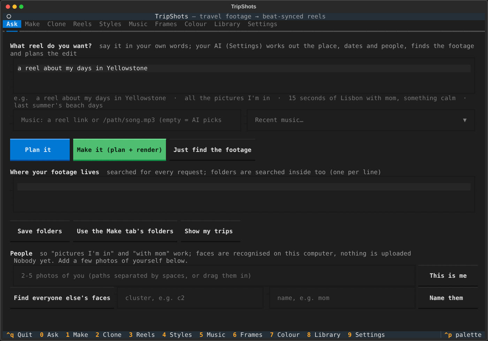

# TripShots

**Turn your own travel photos and clips into beat-synced Instagram Reels, by hand or by asking an AI.**

Point TripShots at a trip folder and a song, or just say *"make a reel about my days in Yellowstone"*. It finds the
right footage, picks the strongest shots, cuts them on the beat, grades the colour, adds text, motion and sound
effects, and renders a 1080×1920 reel ready to post.

Nothing is generated: every frame is your own footage.



```
your footage ─► find shots ─► AI judges each shot ─► beats of the song ─► edit plan ─► 1080×1920 reel
(SSD, phone,     (cuts, blur,    (light, composition,    (cuts on the beat,   (plan.json +     (+ cover, caption,
 drone, GoPro)    shake, GPS)     subject, hook)          calm shots in        storyboard you   EDL, sound design)
                                                          quiet parts)         can edit)
```

## Highlights

- **Ask for footage the way you'd describe it:** by place ("Yellowstone National Park", matched by GPS inside its real outline), dates, or who's in it ("the pictures I'm in", "Lisbon with mom"), using face recognition that runs on your computer.
- **Works with AI agents:** an [MCP server](docs/agents.md) for Claude Code, Claude Desktop, OpenClaw and any MCP agent, plus a portable [agent skill](skills/tripshots/SKILL.md) and `tripshots ask "…"`.
- **Edits like a person would:** an AI (your Claude subscription, MiniMax, or the API) judges every shot; cuts land on the beat; strong shots go on strong beats; landscape footage is reframed to 9:16 around the subject.
- **Looks finished:** per-shot colour grading, transitions on the beat, animated text, titles behind the skyline, split screens, speed ramps, freeze-frames, animated route maps, real sound effects and ambience.
- **Yours to change:** every reel is a readable `plan.json` with a storyboard. Swap a shot, change the hook, re-render; or open it in DaVinci Resolve / Premiere (EDL, OpenTimelineIO).
- **Remembers your footage:** each file is analysed and judged once, by content, so later reels from the same footage are quick.

## Quick start

```bash
git clone <this repository> tripshots && cd tripshots
./install.sh                    # macOS: ffmpeg, Python 3.12 and TripShots (Linux: see docs/getting-started.md)
tripshots doctor                # checks everything

tripshots                       # the app: Ask, Make, Clone, Reels, Styles, Music, Frames, Colour, Library, Settings
```

Or from the command line:

```bash
tripshots make ~/Pictures/Banff -m song.mp3 --dry-run          # plan + storyboard (fast)
tripshots render reels/Banff-beat-montage-<time>.plan.json     # render it
```

Search instead of pointing at folders:

```bash
tripshots footage ~/Pictures/Trips /Volumes/SSD/Footage         # once
tripshots people add me selfie1.jpg selfie2.jpg selfie3.jpg     # once, for "pictures I'm in"
tripshots find --place "Yellowstone National Park" --sheet      # -> sel:1a2b3c4d
tripshots make sel:1a2b3c4d -m song.mp3
tripshots ask "all the pictures I'm in from last summer"        # or just say it
```

## Use it from an AI agent

```bash
claude mcp add tripshots -- tripshots mcp          # Claude Code; see docs/agents.md for others and for HTTP
```

Then ask: *"Create a reel highlighting all the pictures I'm in."* The agent searches your footage, checks the contact
sheet, plans the reel, looks at the storyboard, swaps weak shots, and renders it. Long steps run as background jobs;
contact sheets and storyboards come back as images so the agent can see what it chose.
[More about agents →](docs/agents.md)

## Documentation

| | |
|---|---|
| [Getting started](docs/getting-started.md) | Install (macOS, Linux), first reel, first search, first agent |
| [Making reels](docs/making-reels.md) | Commands, outputs, styles, variants, learning a style, editing, exporting |
| [Finding footage](docs/finding-footage.md) | Search by place, dates and people; trips; face recognition |
| [AI agents](docs/agents.md) · [MCP tools](docs/mcp-tools.md) | MCP server, agent skill, `ask` |
| [Look and motion](docs/look-and-motion.md) · [Colour](docs/colour.md) · [Sound](docs/sound.md) · [Clone](docs/clone.md) | What TripShots can do on screen and in the mix |
| [Commands](docs/cli.md) · [plan.json](docs/plan-format.md) · [Styles](docs/styles.md) · [Configuration](docs/configuration.md) | Reference |
| [Privacy](docs/privacy.md) · [Architecture](docs/architecture.md) · [Troubleshooting](docs/troubleshooting.md) | |

## Requirements

Python 3.10+, ffmpeg 6+, and (recommended) an AI backend: [Claude Code](https://docs.claude.com/en/docs/claude-code)
logged in with a Claude subscription, a MiniMax key, or an Anthropic API key. Without one, TripShots still works on
technical measures alone. Node.js 22+ only for route maps. macOS is the main target; Linux works; Windows is
untested.

## Privacy

Your footage stays on your computer. Face recognition, beat tracking, grading and rendering are local. Small stills
of your shots go to the AI backend you choose; GPS points go to OpenStreetMap for place names; optional features
(Gemini, Openverse sounds, reel downloads) are listed with how to turn them off in [docs/privacy.md](docs/privacy.md).

## Contributing

Issues and pull requests are welcome. See [CONTRIBUTING.md](CONTRIBUTING.md) for setup, tests and conventions, and
the [Code of Conduct](CODE_OF_CONDUCT.md). Security problems: see [SECURITY.md](SECURITY.md).

## License

[MIT](LICENSE). Bundled fonts and adapted code keep their own licences; see
[THIRD_PARTY_NOTICES.md](THIRD_PARTY_NOTICES.md). Music and reels you use remain under their own copyright.

## Credits

Face recognition: OpenCV's [YuNet](https://github.com/ShiqiYu/libfacedetection.train) and
[SFace](https://github.com/opencv/opencv_zoo/tree/main/models/face_recognition_sface). Places:
[OpenStreetMap](https://www.openstreetmap.org/copyright). Route maps: [HyperFrames](https://github.com/heygen-com/hyperframes)
and Natural Earth. Sound rules from [earshot](https://github.com/Leonxlnx/earshot). Camera handling and the Gemini
"watch" idea adapted from [tripcut](https://github.com/divyankrahoria/tripcut) (MIT).
