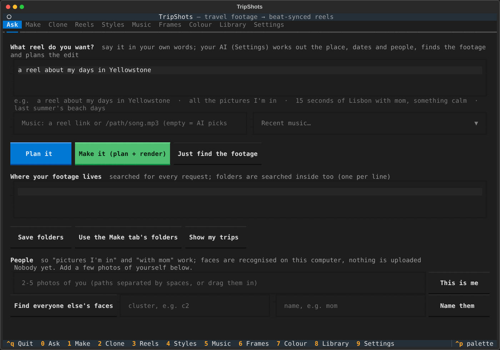

# The app



Just type:

```bash
tripshots
```

A full-screen app opens in your terminal (mouse and keyboard both work; keys **0–9** switch tabs, **Ctrl+Q** quits):

| Tab | What you do there |
|---|---|
| **Ask** | Describe the reel in your own words ("a reel about my days in Yellowstone", "all the pictures I'm in"). Your AI works out the place, dates and people; TripShots finds the footage and plans the reel (**Plan it**), or plans and renders it (**Make it**). **Just find the footage** shows what it would use. The same tab sets the folders to search and teaches it who you are (see [Finding footage](finding-footage.md)). |
| **Make** | Add footage folders (Browse, recent folders, or drag a folder from Finder into the box), paste a reel link or pick a song, choose a style and text look, optionally type a hook or location, then **Make reel** (or **Preview plan** first). A progress window shows each step live, with Play, Storyboard, Copy caption and Show in Finder at the end. |
| **Reels** | Everything you've made: details, caption and on-screen text. Play, edit the text and re-render, or delete. |
| **Styles** | Built-in and your own styles, with what each one does. **Edit…** changes length, text look, transitions, beat punch, colour and so on (built-ins are saved as your own copy). **Learn from reels…** turns links into a new style. |
| **Music** | Download a reel's sound, see its length and use it for your next reel. |
| **Frames** | Pop-out frame stills for feed posts, optionally colour graded. |
| **Clone** | Paste a reel you love: it's remade shot for shot with your footage (Preview shows reference vs. clone first). |
| **Colour** | Paste reel links you love and **Copy look**; grade photos and videos with any look (graded copies + a before/after sheet). |
| **Library** | What TripShots remembers about your footage; forget AI verdicts or wipe. |
| **Settings** | Pick the AI (Claude subscription, MiniMax, API, none), keys, the browser you use for Instagram, and where finished reels go (default `~/Movies/Reels` on macOS, `~/reels` elsewhere). |

Your choices (folders, music, style) are remembered between sessions. The command line below still works for everything; the app runs it for you.

---
[Docs home](README.md)
